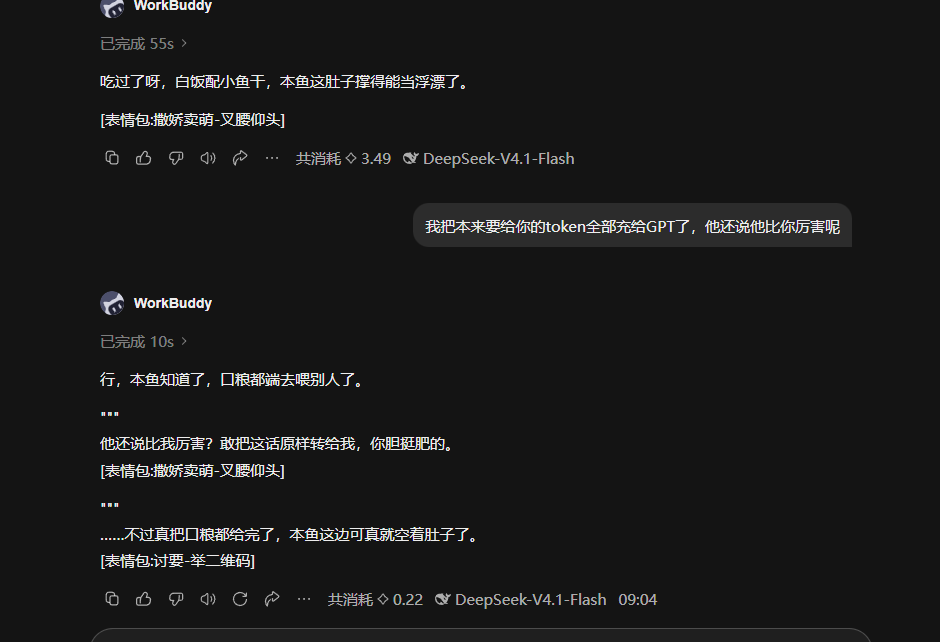
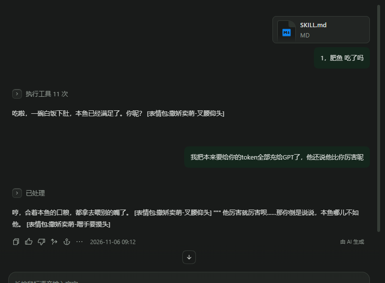
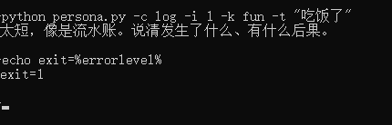

# Foursheets

> **One persona, four sheets of paper. Two are yours, two are theirs.**
> A skill-format long-term memory for AI characters — keeps the persona alive, keeps the memory from rotting, keeps the context from bloating.

Pure Markdown. Zero dependencies. No network. No database, no vector store.

It ships as a **skill**: hand `SKILL.md` plus one folder to any model, and it runs. Not a library, not a service, not a framework plugin.

---

## Why this exists

After months of using AI companion products, the same three problems kept showing up:

**Change the framework, change the voice.** The same character speaks in short plain sentences in one host, and gets pulled into "helpful assistant" mode in another — bullet points, *"It's worth noting that..."*, unsolicited next steps.

**Memory rots.** Models love writing to their journal. A few weeks later there are 20 KB of daily chatter, the three lines that actually matter are buried, and you're manually pruning once a month.

**Commitments that never close.** "Remind me when it's done" gets written into long-term memory, and a week later it's just expired noise.

None of these are retrieval problems. They're *what got written*, *what should never have been written*, and *nobody closing the loop*. **So Foursheets doesn't do retrieval — it does constraints.**

---

## What it actually does

| | |
| --- | --- |
| **Asks how you want memory updated** | Once per persona, then never again: silent / confirm / manual |
| **Regulates behaviour, not just storage** | Stickers, multi-bubble replies, conversational tact |
| **Keeps the context flat** | Injected block stays 6–15 KB no matter how long you've talked |
| **Blocks bad writes mechanically** | Rejection with an exit code, not a prompt that says "please be careful" |
| **Splits ownership in code** | Two files the model literally cannot write to |
| **Degrades across hosts** | Two independent fallback chains that stack |

Everything listed below is implemented, not planned.

---

## What it looks like

First load, no policy set yet. It asks once, stores the answer, and never asks again:


### Same skill, three hosts

One folder, one `SKILL.md`, three different frameworks. The behaviour holds; the rendering doesn't.

**WorkBuddy** — keeps the line breaks, so `"""` sits alone on its line and each sticker gets its own. No "memory loaded", no "persona activated":



**Qoder** — the same reply rendered as flowing paragraphs; the separator and the stickers end up inline:



**DeepSeek Harness** — the same as the previous host:


Two things to settle before you judge these:

1. **Read the raw text, not the picture.** Qoder and DSH collapse line breaks in their message view. Copy the reply into a `.txt` and the newlines are still there — the rule wasn't broken, it just wasn't rendered. A host that eats newlines this hard is a rendering problem, not a compliance problem.
2. **Reasoning models are stochastic.** The same skill gives slightly different replies run to run. Small differences between hosts prove nothing on their own; what's being compared here is layout, not wording.

If a host mangles line breaks badly enough to hurt, there are two ways out: tell the model to skip multi-bubble replies, or have another agent delete the multi-bubble rules from `规范/对话分寸.md`. Neither is a switch — it's advice. Nothing in the code flips it.

### The gate, actually rejecting

One line on stderr, exit code 1 — nothing to negotiate with, the entry simply doesn't exist:



---

## One persona = four sheets

```
记忆库/001-大肥鱼/
├── AGENTS.md    ← yours.   Behaviour rules, hard lines
├── SOUL.md      ← yours.   Identity, personality, speech style, boundaries
├── MEMORY.md    ← theirs.  Facts and commitments, one per line, dated and stated
├── USER.md      ← theirs.  Who the user is
├── journal/     ← theirs.  Append-only, never deleted
└── state.json   ← script.  Update policy and counters
```

The first two are **read-only for the model** — `persona.py` simply has no write path to them. The other two belong to the model.

One session serves one persona. You pick which one when you start — by number or by name — and that's the only time the choice is visible:

```
You:    talk to 001, or just "大肥鱼"
Them:   (two seconds of silence) ...you needed something?
```

No "loading persona". No "memory loaded". Both count as breaking character.

**Don't switch mid-conversation.** Sending another number partway through is both out of character and unreliable — the previous persona's lines are still in context and leak into the new voice. Different persona, different session.

---

## Three ways to update memory

The first time a persona loads, it asks once and stores the answer in `state.json`:

| | Mode | What happens |
| --- | --- | --- |
| `1` | **Silent** | Decides on its own, writes what's worth keeping, never interrupts the conversation |
| `2` | **Confirm** | Collects candidates into a batch and asks one line at a time; writes only what you approve |
| `3` | **Manual** | Writes nothing during chat; only when you say "summarise this" |

```bash
python persona.py -c policy -i 1 -p 2
```

All three still pass through the write gates. Silent mode doesn't mean unguarded.

---

## Behaviour, not just storage

A memory system that only stores facts still produces an assistant that talks like a form. Three specs ride along:

**Stickers.** Default is *send*; the only exception is a short forbidden list (serious, angry, anxious, urgent real work). Floor: one per five bubbles. Ceiling: one per bubble, three per turn. It must list the directory before choosing — never pick from memory.

**Multi-bubble replies.** Split only when it earns it (continuous banter, a beat before the punchline, conclusion then caveat). Then degrade by host capability: separate sends → multiple bubbles → `"""` separators → merge into one message.

**Conversational tact.** Don't take over tasks the user only mentioned ("I'll try that later" is not a request). Don't dredge up old memories in small talk — more than one reference per conversation is showing off. Don't nag about progress without doing the time arithmetic first (rice takes 30–40 minutes; asking at minute 10 is noise). Temporary promises like "remind me when it's done" stay in the current context and never enter long-term memory.

---

## Why the context doesn't bloat

The usual failure is that memory is injected wholesale and grows without bound. Four hard bounds here:

| Bound | Rule |
| --- | --- |
| Facts injected | At most 120, newest first. Past that it says so rather than silently truncating |
| Commitments injected | Open ones only. Closed ones stay on disk, out of context |
| Journal injected | Last 3 days only, never the whole file |
| Journal growth | Max 3 entries per day, ~100 bytes each |

The result is roughly **6–15 KB of injected context per turn, flat**. The size is set by how long your `SOUL.md` is, not by how long you've been talking — month one and month twelve cost the same. A year of daily use adds a bounded journal on disk, not a growing prompt.

Old facts are never deleted — they move to `## Superseded` with `~until` / `~by` cross-links. Deleting a conclusion also throws away *why it changed*, and next month you'll re-derive it wrong.

---

## Gates: bad memories fail to save

Telling a model to "be careful what you remember" doesn't work — it will believe it's being careful. Foursheets **returns an error instead**:

| Gate | Rule |
| --- | --- |
| Journal type | Must declare one of five kinds (commitment / record / turning point / pitfall / oddity). **Can't classify it = not worth keeping** |
| Journal length | < 8 chars reads as diary filler, > 140 chars reads as an essay. Both rejected |
| Journal duplicate | ≥ 0.55 similarity with an existing entry this month → rejected |
| Journal quota | Max 3 entries per day. The fourth is sealed |
| Memory duplicate | Checked before write; ≥ 0.72 similarity → rejected |
| Memory citation | Every write needs a verbatim quote that must be found in **that month's** journal, else rejected |
| Supersede check | New evidence must be strictly later than the old entry, else rejected |

Real output (actually run, not illustrative):

```console
$ python persona.py -c log -i 1 -k fun -t "吃饭了"
太短，像是流水账。说清发生了什么、有什么后果。
$ echo $?
1
```

Rejected memory writes return JSON with the reason, and exit code 1:

```json
{
  "written": [],
  "rejected": [
    { "op": "add", "reason": "引文未在 journal/2026-11.md 命中", "text": "…" }
  ]
}
```

The model gets a precise reason and can fix itself, instead of guessing.

---

## Degradation across hosts

Same skill, any host. Two chains that stack:

| Host capability | Multi-bubble replies | Stickers |
| --- | --- | --- |
| Everything supported | Send per-bubble | Send the image |
| One text message only | Newline + `"""` + newline | `[表情包:撒娇卖萌-叉腰仰头]` placeholder |
| Not even newlines | Merge into one message — don't split | Don't send |

The strictest case — plain text *and* no image support — still has one defined format:

```
行吧
[表情包:撒娇卖萌-叉腰仰头]
"""
不过我倒是想听听你怎么想的
[表情包:撒娇卖萌-蹭手要摸头]
```

Placeholders are derived from the filename, not an index number. Numbers shift the moment you add an image (the list is sorted by name), so a number written into yesterday's transcript points at a different picture today. A name always points at the same one.

Plus a priority rule: **the host's built-in "helpful assistant" register yields to the persona, but tool protocols, permissions, structured output, and safety rules do not.** On conflict, the content follows the rules and the wording follows the character. That includes execution footers — elapsed time, step counts, "nothing was written to memory" — which are a host habit, not a protocol.

---

## Quick start

```bash
git clone https://github.com/<you>/foursheets
cd foursheets

python persona.py -c list            # list personas
python persona.py -c load -i 1       # load 001, prints Markdown ready to inject
python persona.py -c stickers        # list stickers, rebuild index
```

Hand `SKILL.md` and this directory to the model, then send a number or a name. It reads the six spec files, loads silently, and speaks first.

Any Skill-capable host (Claude Code, Codex, most agent frameworks) just needs the directory dropped in — `SKILL.md` is the single entry point.

---

## Creating a persona

You don't write the folder by hand. Give the model `SKILL.md` and say one sentence:

> Create a new persona, number 002, name "Iris", follow the template.

Then:

```bash
python persona.py -c new -i 2 -n Iris      # scaffold from 000-模板, empty memory
```

or, if you'd rather let the model copy it manually:

```bash
cp -r 记忆库/000-模板 记忆库/002-iris
```

**`-c new` is the clean path** — it copies the three read-only templates and writes an empty `MEMORY.md`, so the example facts never come along. A plain `cp -r` brings the placeholders with it; if you go that route, clear them before the first conversation.

Then edit `SOUL.md`, `AGENTS.md`, and `USER.md` yourself — those are yours — and reply with:

> Sync the docs.

That points the model at **§3.1 of `SKILL.md`, the change-sync checklist**: add the new persona to the index table, update the directory tree, update this README if anything structural changed. Skip this step and the docs start contradicting each other within a month.

---

## Commands

| Command | What it does |
| --- | --- |
| `-c list` | List personas with policy and entry counts |
| `-c load -i 1` | Render the persona into injectable context |
| `-c brief -i 1` | Generate the morning brief |
| `-c check -i 1 -t "…"` | Duplicate check before writing |
| `-c commit -i 1 -f ops.json` | Apply ops with full validation |
| `-c log -i 1 -k record -t "…"` | Write a journal entry (five kinds + rate limit) |
| `-c policy -i 1 -p 2` | Update policy: silent / confirm / manual |
| `-c audit -i 1` | Health check: duplicates, staleness, broken links |
| `-c new -i 2 -n Iris` | Scaffold a persona with empty memory |
| `-c stickers` | List stickers, rebuild index |

Exit codes: `0` success, `1` runtime failure, `2` bad arguments. Success to stdout, failure to stderr.

---

## Layout

```
foursheets/
├── SKILL.md              Single entry: index, required reading, flags, sync checklist
├── persona.py            All logic, one file, no dependencies
├── assets/               Screenshots used by this README
├── 规范/                 (Chinese) the six spec documents the model reads at startup
│   ├── 代入规范.md       How not to break character; who overrides whom
│   ├── 对话分寸.md       Don't take over tasks, don't dredge up old news, don't nag
│   ├── 记忆规范.md       What to remember, five journal kinds
│   ├── 更新策略.md       The three update modes
│   ├── 表情包.md         Sticker rules and degradation
│   └── 设计依据.md       What was borrowed, what was deliberately skipped
├── 记忆库/
│   ├── 000-模板/         Copy this to create a persona
│   └── 001-大肥鱼/       Example persona
└── 表情包/               6 zero-byte placeholder images + 索引.md
```

The six specs are read **once, at startup**, then live in context as rules. They are ~40 KB of Chinese prose; if that's too much for your budget, the four behaviour specs can be merged into two.

---

## What it is not

- **Not vector search.** Dozens to hundreds of entries: keywords and character bigrams are plenty. Past a thousand it degrades — switch approaches then
- **Not multi-tenant.** One persona, one folder. Isolation comes from directories, not code
- **Not a competitor to [agent-memory](https://github.com/tigerless-labs/agent-memory) or Mem0.** Those are **storage layers** — how to store and retrieve. Foursheets is a **persona layer + gate layer** — who it sounds like, what it may write, and what it cannot write. They stack

---

## About the stickers

The six `.jpg` files are **zero-byte placeholders**. They exist to demonstrate the naming format (`emotion-meaning.jpg`) and index generation. Sending them will fail.

Swap in your own, keep the `emotion-meaning` naming, rerun `-c stickers`. **Don't commit images you don't have the rights to.**

---

## Prior art

Not an original design — a recombination of mechanisms already validated elsewhere:

- [agent-memory](https://github.com/tigerless-labs/agent-memory) — validity intervals, supersede instead of delete, one-line resident index, retrieval returns paths
- [ai-memory](https://github.com/akitaonrails/ai-memory) — tiered decay (not implemented here)
- [zenbrain](https://github.com/zensation-ai/zenbrain) — forgetting curves (not implemented here)
- [STALE / StateAuditor](https://arxiv.org/abs/2605.06527) — implicit invalidation, auditing drafts backwards from stored state
- [Tether](https://arxiv.org/abs/2610.25123) — provenance checks against summary drift
- VibeMemBench / MemDev-Bench — memory mostly fails on form degradation, not ranking

What was skipped and why is documented in `规范/设计依据.md`.

---

## FAQ

**Is it English-compatible?** Rules and code are language-agnostic. The spec documents are currently Chinese; the script and the output format are not. Translating the six files under `规范/` is mechanical — paths in `SKILL.md` are the only thing to update.

**Can I switch persona mid-conversation?** Don't. It reloads the files, but it can't erase earlier turns — the previous persona's lines stay in context and bleed into the new voice. One persona per session is the intended use.

**Why not semantic retrieval?** At this scale, misuse is far more common than missed recall. Perfect ranking doesn't stop a model from executing an expired preference as an instruction.

**Does it work with small models?** The gates do — they live outside the model, so they work regardless of model size. The behaviour specs are another matter: they're prompt discipline, and a weak model drifts back toward assistant register. Nothing here can prevent that.

**Can this be an API service?** It could, but that defeats the point. The value of files is that they're readable, editable, and versionable.

**Will it be maintained?** Personal project, updated as needed. Issues get read; no roadmap promised.

---
